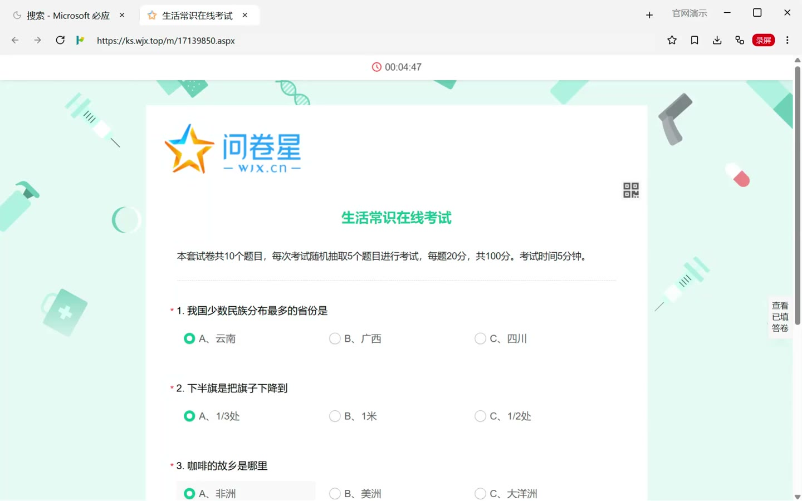

<p align="center">
  
</p>

<h1 align="center">BrowserPilot</h1>

<p align="center">
  <strong>The browser you are already signed in to — now driven by your agent.</strong>
</p>

<p align="center">
  Logins stay in an isolated environment on your machine. You open the window,<br>
  the agent keeps working in that same window: no second browser, no second login.
</p>

<p align="center">
  <a href="https://browser.xyun.dev/">🌐 Website</a> •
  <a href="https://browser.xyun.dev/en/guide/quickstart">📖 Docs</a> •
  <a href="https://github.com/xy200303/browserpilot/releases/latest">📦 Download</a> •
  <a href="https://github.com/xy200303/browserpilot-market">🛒 Workflow market</a> •
  <a href="skills/browserpilot/SKILL.md">🤖 Agent setup</a>
</p>

<p align="center">
  <a href="https://browser.xyun.dev/"></a>
  <a href="https://github.com/xy200303/browserpilot/releases/latest"></a>
  
  
  
</p>

<p align="center">
  <a href="README.md">English</a> · <a href="README.zh-CN.md">简体中文</a>
</p>

---

## ▶️ Watch it run

[](https://browser.xyun.dev/#demo)

A real task: open a "general knowledge" exam on Wenjuanxing, read each question, pick answers, submit — five out of five, 100 points. Thirteen seconds, silent loop; play it on the [home page](https://browser.xyun.dev/#demo), the file is [run.mp4](website/public/demos/run.mp4).

## ✨ Features

|     | Feature | What it does |
| --- | ------- | ------------ |
| 🪟 | **Human and agent, same window** | You sign in and solve captchas; the agent continues in that window. An overlay says the agent is working, and you can take over at any moment |
| 🕘 | **Everyday browsing** | History and bookmarks isolated per environment; address bar select-all with history and bookmark completion; last session restored on start; error pages, progress bar; tab search and hibernation |
| 🔑 | **Passwords** | Credentials are saved on submit and filled next time in the same environment. Encrypted with the system keychain and stored locally; review or delete them in Settings. Without a usable keychain (common on headless Ubuntu) they fall back to local encoding and Settings marks them as unencrypted |
| 🗂️ | **Data tools** | Bookmarks, history, sessions and cookies all have agent tools: list, add, remove, clear by domain — no UI clicking |
| 🛡️ | **Privacy** | Clear history, cookies and cache per environment; site permission prompts (camera, microphone, notifications, location) with remember-this-choice |
| 🔐 | **Isolated environments** | Many environments in one process, each with its own window and its own login state. Closing a window keeps the logins |
| 🔄 | **Workflow engine** | Node graphs (click, fill, loop, script, captcha) run end to end without asking each time; one-click install from the built-in market |
| 🎬 | **Streaming media** | Bilibili, Douyin and YouTube DASH tracks merged into mp4; m3u8 for CCTV and AcFun; Sohu segmented mp4 merged; Tencent player streams via CDP sniffing |
| 🧩 | **Captchas** | Geetest sliders fully automatic (cv, ddddocr and onnx engines with fallback); any other type is screenshotted for a vision model, no type list to maintain |
| 🖱️ | **Human-like input** | Drag tracks with acceleration, jitter and slight overshoot; piercing through shadow DOM and iframes; scripts inside cross-origin iframes |
| 📥 | **Downloads** | All page downloads are captured: progress, resume, copy link, agent-saved media included. Agents use `download` (`action: list`, optionally waiting) to find files on disk, pause, resume, cancel, retry, open, remove, or change the folder |
| 🎨 | **Canvas drawing** | Path points, SVG paths with beziers, turtle commands — whiteboards, signature pads, Canva |
| 📹 | **Screenshots and recording** | Viewport screenshots returned to the agent; composited app preview including overlays; window recording to mp4; page video via captureStream when tracks cannot be fetched |
| 🧭 | **Diagnostics** | Console and JS errors, find in page, load waiting; alert and confirm answered by policy so tabs never block; screenshots carry a coordinate grid by default (`grid`, can be turned off) with viewport coordinates for pages and content-area coordinates for the app |
| 🪟 | **Lifecycle** | Close a window and keep logins, switch headed or headless at runtime, reopen closed tabs, duplicate, mute or close other tabs |
| 🧰 | **Tools on demand** | MCP exposes core tools by default and the rest through `search_tools` (names, descriptions, groups, pagination, schemas); Settings can switch back to everything |
| 🕵️ | **Network capture** | Per-tab HTTP recording and HAR export; cookies in headers never leave the machine |
| 🖱️ | **Context menus by element** | Links open in a new tab, images and media save as, with the system save dialog |

---

## 💡 Engineering notes

### Who is driving

A tab has three states: user, agent, shared. When the agent takes the wheel an overlay covers the page; the user can take over instantly and the agent locks it again when done. Logins always live in the environment's own session partition, so both sides see the same page and the same cookies.

### One pipeline for every streaming site

A single `page_save_media` call sits on top of layered extraction: site providers (Bilibili `__playinfo__`, YouTube `ytInitialPlayerResponse`, one file per platform under `media/video/`) → performance entries (DASH tracks, progressive mp4, m3u8) → CDP network sniffing for player workers → reload and re-read the manifest when needed. ffmpeg is downloaded into the user directory and merging happens locally.

### Three engines for captchas

Slider captchas degrade through cv (built-in vision, no dependencies) → ddddocr → onnx. The drag uses a human-like track and retries with a fresh image on failure. Anything else (icon picking, board games) is screenshotted with a coordinate mapping and handed to a vision-capable agent.

---

## 🚀 Getting started

### 1. Install

Download from [Releases](https://github.com/xy200303/browserpilot/releases/latest) (builds are not code-signed):

| Platform | Files |
| -------- | ----- |
| Windows x64 | `BrowserPilot.Setup.<version>.exe`, `BrowserPilot-<version>-win.zip` |
| macOS (Apple Silicon) | `BrowserPilot-<version>-arm64.dmg`, `BrowserPilot-<version>-arm64-mac.zip` |
| Linux x64 | `BrowserPilot-<version>.AppImage`, `browserpilot_<version>_amd64.deb` |

> ⚠️ **Windows**: if SmartScreen reports an unknown publisher, choose More info → Run anyway.
> ⚠️ **macOS**: if macOS says the app is damaged, run `xattr -cr /Applications/BrowserPilot.app`.

### 2. Hand it to your agent

Open BrowserPilot and check that MCP is enabled in Settings → General. Then send this to Claude Code, Kimi Code, Codex, Cursor, WorkBuddy or CodeBuddy:

```text
Install the BrowserPilot skill: read https://raw.githubusercontent.com/xy200303/browserpilot/main/skills/browserpilot/SKILL.md and install it into your user-level skills directory. Then read the local BrowserPilot mcp.json (on Windows: %APPDATA%\BrowserPilot\mcp.json) and register only the server named browserpilot in your own configuration; leave other servers untouched. Use this skill to operate BrowserPilot afterwards.
```

The connection token lives in the local `mcp.json`, never in the repository, and should not be pasted into chat. You can also open Settings → General → Connect an agent and press Copy prompt: it contains the MCP address and token, the skill URL and CLI usage, enough for an agent to wire itself up.

### 3. Command line (optional)

The CLI is the fallback when MCP is unavailable. On Windows the installed app puts `browserpilot` on PATH (it starts the app if no window is open):

```bash
browserpilot tools                 # list every tool
browserpilot search screenshot     # search by keyword (name, description, group)
browserpilot search page --page 2 --page-size 5   # paginate; --json for raw output
browserpilot schema page_click     # show parameters
browserpilot call page_navigate --json-file nav.json   # non-ASCII arguments via JSON file
```

---

## 🛒 Workflow market

The Workflows button on the right of the address bar opens the market: search, install, fill parameters and run, or hand it to an agent that calls `workflow_run`. The catalog is a separate repository, [xy200303/browserpilot-market](https://github.com/xy200303/browserpilot-market), fetched from GitHub on every open.

Current entries include BOSS Zhipin auto-apply (salary filtering in a loop, captcha handling), Bilibili download by BV id, stock forum scraping to CSV, and Geetest sliders. To publish your own: submit the JSON to that repository and register it in `index.json`; the app only downloads, never uploads.

---

## 🛠️ Local development

```bash
npm install
npm run dev          # development
npm run typecheck    # type checking
npm run build        # build
npm run dist:win     # package for the current platform (dist:mac, dist:linux)
npm run deploy:win   # skip the installer: overwrite the install dir and restart
```

Pushes to `main` run typecheck and build; pushing a tag that matches `package.json` (for example `v0.19.0`) makes CI package on Windows, macOS and Linux and publish a release.

The website lives in `website/`:

```bash
cd website
npm install
npm run dev
```

`.github/workflows/pages.yml` publishes it to GitHub Pages on pushes touching `website/**`; the live site is [browser.xyun.dev](https://browser.xyun.dev/).

## 📁 Layout

```
├── src/main/          # main process: windows, tabs, environments, page control, capture
│   ├── media/         # media saving: video/ image/ audio/ canvas/ by kind
│   │   └── video/     #   one provider per platform (bilibili.ts, youtube.ts…)
│   ├── services/      # MCP, workflow engine, downloads, capture, ffmpeg
│   └── captcha.ts     # captcha detector registry
├── src/preload/       # page context-menu signals, performance buffer resize
├── src/renderer/      # React UI (tab strip, settings, downloads, workflow editor)
├── cli/               # Go CLI over the same tool catalog as MCP
├── skills/            # agent instructions (SKILL.md)
├── website/           # site and docs (VitePress, browser.xyun.dev)
└── .github/           # three-OS packaging and Pages deployment
```

---

## 💬 Feedback

Issues and suggestions are welcome in [Issues](https://github.com/xy200303/browserpilot/issues).
